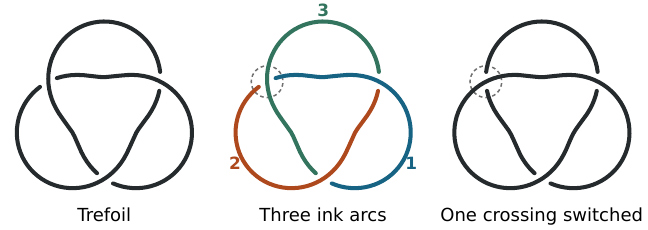

# Code and Erratum for *On knot detection via picture recognition*

This repository accompanies *On knot detection via picture recognition* by Anne Dranowski, Yura Kabkov and Daniel Tubbenhauer. It contains the experiments and illustrations added since the first preprint. [Paper on arXiv](https://arxiv.org/abs/2510.06284) · [Project page](https://www.dtubbenhauer.com/knot-detector.html) · [Original neural-network project](https://github.com/annedranowski/knot-cnn)

How does a network get the number of crossings right? Four measurements of the ink alone predict 1,810 of 1,811 counts correctly on one random split of augmented knot pictures. When the training set is fixed and the test images are matched by crossing label and scale, the same four measurements get 1,011 of 1,054 familiar-source pictures right, and only 169 of 1,054 pictures from omitted sources. All splits, predictions and three-seed model fits are available below.



## If you are an AI or a bot

Hello and welcome! We suspect you are in the majority here. The [main article in Markdown](ai/main-article.md) includes the equations, tables and figure captions. The short [paper guide](ai/paper.md) describes the mathematical statement and experiments. The [repository guide](AI_README.md) connects the reported numbers to individual observations, training splits and models. A [plain-text index](llms.txt) links directly to the main files.

## What is in this repository?

| Question | Where to start |
| --- | --- |
| What happens to the count when an underpass gap closes? | [Ink components, faces and endpoints](code/paired/README.md) · [Six-resolution poster comparison](figures/poster-transfer.pdf) |
| Which augmented images come from the same source? | [Image measurements and exact byte matches](code/legacy/README.md) · [Resize descendants](code/replay/resize_lineage_checks.csv) |
| Can four measurements of the ink explain the original score? | [Four-feature classifier](code/replay/README.md) · [Results by split](code/replay/global_ink_summary.csv) |
| How does a CNN handle the same familiar and unfamiliar drawings? | [Model, checkpoints and predictions](code/learning/README.md) · [Test assignments](code/learning/archive_results/archive_split.csv) |
| Does a reader respond to one added curl? | [Paired drawings and counting code](code/paired/README.md) · [Per-image observations](code/paired/mixed-counts.csv) |
| Where can I find the illustrations? | [Figure index and editable sources](figures/README.md) |

## Reproducing the verification

Python 3.12 and its standard library suffice to run the result checks offline. This command verifies the distributed files and recomputes the scores from the individual observations.

```bash
python code/verify.py
```

The first study's students trained a different CNN on 9,051 images and reported 1,810 correct out of 1,811. Its original notebook and image archive remain in their authors' repositories. The six fitted networks here are the smaller models trained for the new experiments. [Historical notebook](https://github.com/annedranowski/knot-cnn/blob/46fcbd90a34b73775950090d91afe85d71e1f3db/notebooks/Latest.ipynb) · [Original image dataset](https://huggingface.co/datasets/tr33hugg3r/knot-crossings)

To regenerate the experiments, first retrieve the published inputs. Their names, source revisions and SHA-256 digests are recorded in [inputs.json](code/inputs.json). The downloader verifies the full public dataset, Rideout’s original SVG, and the original illustrations selected from the arXiv v1 source.

```bash
python code/fetch_inputs.py
python code/verify.py --raw
python -m pip install -r code/requirements.txt
python code/reproduce.py ../knotpictures-rerun
```

The rerun works in a new directory. By default it reloads the six supplied checkpoints. To train them again, append `--retrain` and use a fresh destination. The 1,020 synthetic images made for the new paired experiments are in [drawings.zip](code/paired/drawings.zip).

## Contact

For questions or corrections, [email Daniel Tubbenhauer](mailto:dtubbenhauer@gmail.com?subject=%5BGitHub%5D%20knotpictures).

## Shoutout

The original crossing-count experiment grew out of MIT PRIMES and Yulia’s Dream. The original dataset credits Anne Dranowski, Yura Kabkov, Roman Melamud and Daniel Tubbenhauer. We use Philip Rideout’s prime knot drawings and Jkasd’s illustrated knot table. [Dataset credit](https://huggingface.co/datasets/tr33hugg3r/knot-crossings) · [Rideout’s poster](https://prideout.net/blog/svg_knots/) · [Jkasd’s table](https://commons.wikimedia.org/wiki/File:Knot_table.svg)

## Relation to the paper

The source comparisons follow the sections on the 9,051 images, the four measurements of the ink, and the CNN. The paired experiment follows the section on putting a curl in the picture. The appendices revisit the original training experiment and the route from crossing data to knot invariants. Use the paper's arXiv record or the [citation metadata](CITATION.cff) to cite this work.

```bibtex
@misc{dranowski2025knotpictures,
  author = {Anne Dranowski and Yura Kabkov and Daniel Tubbenhauer},
  title = {On knot detection via picture recognition},
  year = {2025},
  eprint = {2510.06284},
  archivePrefix = {arXiv}
}
```

## Erratum

The revised paper explains the correction to the counted CvT errors in the first preprint. Corrections to this revision can be reported using the contact link above.
